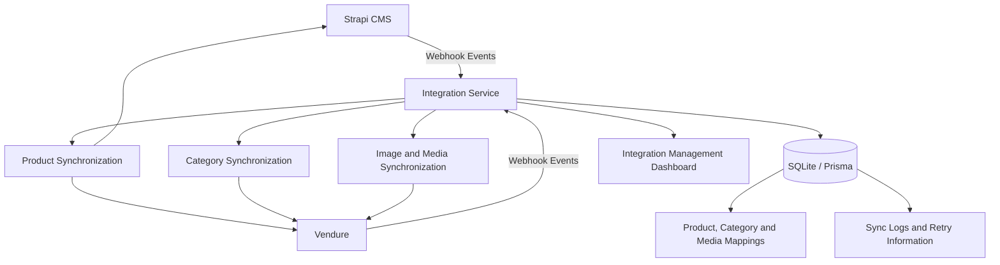

# Vendure–Strapi Bidirectional Integration

A webhook-driven bidirectional integration between **Vendure 3.8.1** and **Strapi 5.62.0**.

The project connects Vendure's e-commerce capabilities with Strapi's content management capabilities through a centralized Integration Service. It synchronizes product information, categories, media, and commerce-related data while maintaining cross-system ID mappings and synchronization logs.

## 1. Project Overview

The integration consists of three applications:

- **Vendure:** E-commerce backend and source of truth for product variants, SKUs, pricing, stock, and commerce availability.
- **Strapi:** Headless CMS and source of truth for product content, categories, media, SEO, and specifications.
- **Integration Service:** Connects both systems, processes webhooks, synchronizes data, stores mappings, handles retries, and provides a monitoring dashboard.

The Integration Service uses SQLite and Prisma to persist mappings and synchronization events.

## 2. Features

- Bidirectional product synchronization between Strapi and Vendure.
- Product content synchronization, including names, descriptions, and slugs.
- Product image and gallery synchronization.
- Strapi Category to Vendure Collection mapping.
- Product specifications and SEO metadata synchronization.
- Product and variant commerce information synchronization.
- Product and category ID mapping across both systems.
- Media and asset ID mapping.
- Secure webhook authentication.
- Duplicate webhook event protection.
- Persistent synchronization logs.
- Automatic retry processing for failed synchronization events.
- Manual product synchronization from the dashboard.
- Manual retry of failed events.
- Dashboard for monitoring mappings, processed events, and failed events.
- Health endpoint for checking Integration Service and database connectivity.

## 3. Technology Stack

| Application | Technologies |
|---|---|
| E-commerce Backend | Vendure 3.8.1 |
| CMS | Strapi 5.62.0 |
| Integration Service | Node.js, TypeScript, Express 5 |
| Integration Database | SQLite |
| ORM | Prisma 7 |
| Database Driver | better-sqlite3 |
| Monitoring Dashboard | HTML, JavaScript, Express |
| Webhook Security | HMAC signature and shared-secret verification |

## 4. Project Structure

```text
Vendure-Strapi-Integration/
│
├── vendure/
│   └── Vendure e-commerce application
│
├── strapi-cms/
│   └── Strapi headless CMS application
│
├── integration-service/
│   ├── prisma/
│   │   ├── migrations/
│   │   └── schema.prisma
│   │
│   ├── generated/
│   │   └── prisma/
│   │
│   ├── src/
│   │   ├── routes/
│   │   │   ├── dashboard.ts
│   │   │   └── webhooks.ts
│   │   │
│   │   ├── category-sync.ts
│   │   ├── image-sync.ts
│   │   ├── middleware.ts
│   │   ├── product-sync.ts
│   │   ├── retry-worker.ts
│   │   ├── server.ts
│   │   ├── strapi-to-vendure.ts
│   │   ├── strapi.ts
│   │   └── vendure.ts
│   │
│   ├── prisma7.config.ts
│   └── package.json
│
├── docs/
│   ├── decisions.md
│   └── webhook-contract.md
│
├── webhook-test-receiver.cjs
├── .gitignore
└── README.md
```

## 5. Architecture

The Integration Service acts as the communication layer between Vendure and Strapi.



### Main Components

**Vendure**

Manages e-commerce product and variant information, including identifiers, SKUs, prices, stock, and availability.

**Strapi**

Manages product content, categories, images, descriptions, SEO metadata, and specifications.

**Integration Service**

Receives webhook events, verifies requests, identifies related records, executes synchronization operations, and records their results.

**Integration Database**

Stores cross-system mappings and event-processing information.

**Integration Dashboard**

Displays synchronization statistics, mappings, event history, and available manual synchronization and retry actions.

## 6. Data Ownership and Mapping

The integration follows a field-ownership approach to reduce conflicting updates between systems.

| Data | Source of Truth | Destination |
|---|---|---|
| Product name | Strapi | Vendure |
| Product description | Strapi | Vendure |
| Product slug | Strapi | Vendure |
| Product images and gallery | Strapi | Vendure |
| Product category | Strapi | Vendure Collection |
| Product specifications | Strapi | Vendure |
| SEO metadata | Strapi | Vendure |
| Variant display labels | Strapi | Vendure |
| Product and variant IDs | Vendure | Strapi |
| Product and variant SKUs | Vendure | Strapi |
| Variant prices | Vendure | Strapi |
| Stock information | Vendure | Strapi |
| Commerce availability | Vendure | Strapi |

### Mapping Database

The Integration Service maintains four main Prisma models:

| Model | Responsibility |
|---|---|
| `ProductMapping` | Connects Strapi Product document IDs with Vendure Product IDs. |
| `CategoryMapping` | Connects Strapi Category document IDs with Vendure Collection IDs. |
| `MediaMapping` | Connects Strapi media document IDs with Vendure Asset IDs. |
| `SyncLog` | Stores webhook events, processing status, errors, and retry information. |

Strapi's `documentId` and Vendure's product and collection IDs are maintained through these mappings.

### Product Commerce

Strapi also maintains a Product Commerce record containing Vendure-related commerce information, such as:

- Vendure Product ID.
- Commerce enabled status.
- Variant commerce snapshot.
- Synchronization status.
- Last synchronization timestamp.

This record is a representation of relevant Vendure commerce data. Vendure remains authoritative for commerce information.

## 7. Synchronization Workflow

### Strapi to Vendure

1. A product or category is created or updated in Strapi.
2. Strapi sends a webhook to the Integration Service.
3. The Integration Service verifies the webhook secret.
4. The event is saved in the synchronization database.
5. Duplicate events are identified and ignored.
6. The Integration Service retrieves the relevant Strapi content.
7. Product content, images, categories, SEO, and specifications are synchronized to Vendure.
8. The mapping and synchronization log are updated.

Supported Strapi event types include product and category creation, update, and publication. Product deletion is handled by archiving the mapped Vendure product.

### Vendure to Strapi

1. A product, variant, stock, or price-related change occurs in Vendure.
2. Vendure sends a signed webhook to the Integration Service.
3. The Integration Service verifies the webhook signature and timestamp.
4. The event is stored in the synchronization database.
5. Duplicate events are checked.
6. The relevant Vendure Product ID is identified.
7. The Integration Service retrieves the product mapping.
8. Commerce-related information is synchronized to Strapi.
9. The Product Commerce record and synchronization log are updated.

This includes commerce status changes. For example, disabling a product in Vendure updates its corresponding commerce status in Strapi.

## 8. Webhook Endpoints

The Integration Service provides two webhook endpoints:

| Source | Method | Endpoint |
|---|---|---|
| Vendure | POST | `/webhooks/vendure` |
| Strapi | POST | `/webhooks/strapi` |

Full webhook payload details and communication rules are documented in [`docs/webhook-contract.md`](docs/webhook-contract.md).

### Webhook Security

**Vendure**

Uses HMAC SHA-256 signature verification with timestamp validation.

Headers:

- `X-Webhook-Timestamp`
- `X-Webhook-Signature`

**Strapi**

Uses a shared webhook secret passed through the `X-Strapi-Webhook-Secret` request header.

Webhook secrets must be configured consistently in the sending application and Integration Service.

## 9. Duplicate Prevention and Error Handling

The Integration Service stores webhook events in the `SyncLog` table.

Duplicate protection includes:

- Using provider event IDs when available.
- Generating a SHA-256 event identifier from the request body when a provider event ID is unavailable.
- Enforcing a unique constraint on `SyncLog.eventId`.
- Handling simultaneous duplicate insertions.

Synchronization errors are recorded with their error messages and processing status.

### Automatic Retry

The retry worker:

- Checks for due failed events periodically.
- Processes eligible retry records.
- Tracks retry attempts and timestamps.
- Uses increasing retry delays.
- Limits automatic retries to five attempts.
- Marks exhausted events with a retry-exhausted status.

The retry worker starts automatically when the Integration Service starts.

### Manual Retry

The dashboard provides a manual retry action for failed or retry-exhausted events. A manual retry resets the retry attempt count and queues the event for processing.

## 10. Integration Dashboard

The dashboard is served by the Integration Service.

**Dashboard URL:** `http://localhost:4000/dashboard`

It provides the following information:

- Product mapping count.
- Category mapping count.
- Media mapping count.
- Processed event count.
- Failed event count.
- Product mappings.
- Category mappings.
- Media mappings.
- Synchronization event history.
- Event status and error information.

It also supports manual product synchronization in both directions and manual retry of eligible failed events.

### Dashboard API Endpoints

| Method | Endpoint | Purpose |
|---|---|---|
| GET | `/dashboard/api/overview` | Dashboard statistics |
| GET | `/dashboard/api/products` | Product mappings |
| GET | `/dashboard/api/categories` | Category mappings |
| GET | `/dashboard/api/media` | Media mappings |
| GET | `/dashboard/api/logs` | Synchronization logs |
| POST | `/dashboard/api/products/:vendureProductId/sync` | Manual product synchronization |
| POST | `/dashboard/api/retry/:id` | Queue a manual retry |

Manual synchronization accepts either `vendure-to-strapi` or `strapi-to-vendure` as its direction.

## 11. Installation and Setup

### Prerequisites

- Node.js 22 or later, within the Strapi-supported Node.js range.
- npm.
- Git.

### Step 1: Clone the Repository

```powershell
git clone <YOUR_GITHUB_REPOSITORY_URL>
cd Vendure-Strapi-Integration
```

### Step 2: Configure Environment Variables

Create and configure the required `.env` files in:

- `vendure/.env`
- `strapi-cms/.env`
- `integration-service/.env`

Do not commit real API tokens, passwords, or webhook secrets.

**Vendure environment variables**

Configure the following:

```env
APP_ENV=
VENDURE_SERVER_PORT=
COOKIE_SECRET=
SUPERADMIN_USERNAME=
SUPERADMIN_PASSWORD=
CORS_ORIGINS=
INTEGRATION_WEBHOOK_URL=http://localhost:4000/webhooks/vendure
WEBHOOK_SECRET=
```

**Strapi environment variables**

Configure the Strapi server, database, application secrets, API token settings, and webhook secret. Use the provided `strapi-cms/.env.example` as a starting point.

**Integration Service environment variables**

```env
DATABASE_URL=file:./dev.db
PORT=4000
STRAPI_URL=http://localhost:1337
STRAPI_API_TOKEN=
VENDURE_URL=http://localhost:3000
STRAPI_WEBHOOK_SECRET=
```

Use the actual API token and matching webhook secrets from your local application configuration.

Configure the Strapi webhook to send events to:

```text
http://localhost:4000/webhooks/strapi
```

Set its `X-Strapi-Webhook-Secret` header to the same secret configured in the Integration Service.

### Step 3: Install and Start Vendure

Open a terminal:

```powershell
cd vendure
npm install
npm run dev
```

Vendure runs using its configured server port. The default local server URL for this project is:

```text
http://localhost:3000
```

### Step 4: Install and Start Strapi

Open another terminal:

```powershell
cd strapi-cms
npm install
npm run develop
```

Strapi runs at:

```text
http://localhost:1337
```

The admin panel is available at:

```text
http://localhost:1337/admin
```

### Step 5: Set Up the Integration Service

Open another terminal:

```powershell
cd integration-service
npm install
```

Generate the Prisma client and apply database migrations:

```powershell
npx prisma generate --config prisma7.config.ts
npx prisma migrate deploy --config prisma7.config.ts
```

Check TypeScript:

```powershell
npm run typecheck
```

Start the Integration Service:

```powershell
npm run dev
```

The service runs at:

```text
http://localhost:4000
```

The retry worker starts automatically with the service.

### Step 6: Verify the Integration Service

Open:

```text
http://localhost:4000/health
```

A healthy response should report:

```json
{
  "status": "ok",
  "service": "integration-service",
  "database": "connected"
}
```

Open the Integration Management Dashboard:

```text
http://localhost:4000/dashboard
```

## 12. Design Decisions

Important architecture and implementation decisions include:

- Vendure remains the source of truth for commerce-related data.
- Strapi remains the source of truth for product content.
- The Integration Service handles communication and synchronization rather than placing integration logic inside either application.
- Product, category, and media mappings are stored centrally.
- Product Commerce is maintained separately from the Strapi Product content.
- Webhook requests are authenticated before processing.
- Unique event IDs and database constraints support duplicate prevention.
- Failed synchronization events are persisted for retry and investigation.
- SQLite provides a local database without requiring Docker or Redis.
- The integration uses a single-language, single-channel, and single-currency initial scope.

For more details, see [`docs/decisions.md`](docs/decisions.md).

## 13. Current Scope and Limitations

- The project is designed for local development and demonstration.
- Category deletion is not currently handled by the Strapi webhook flow.
- Unsupported webhook events are recorded as ignored.
- Vendure events without an existing product mapping are ignored by the product synchronization flow.
- The initial scope is limited to one language, channel, and currency.
- A dedicated automated test suite is not configured in the current Integration Service package. TypeScript validation is available through `npm run typecheck`.

## 14. Documentation

Additional technical documentation:

- [`docs/decisions.md`](docs/decisions.md) — Architecture, field ownership, mapping, and design decisions.
- [`docs/webhook-contract.md`](docs/webhook-contract.md) — Webhook payloads and communication rules.

## 15. Demo Video

The demo video demonstrates:

- Integration architecture and dashboard overview.
- Strapi-to-Vendure product synchronization.
- Vendure-to-Strapi commerce status synchronization.
- Product availability changes.
- Synchronization logs and monitoring.

**Demo Video:** Add the uploaded video link here.

## 16. License

This project was developed as a full-stack integration assignment.